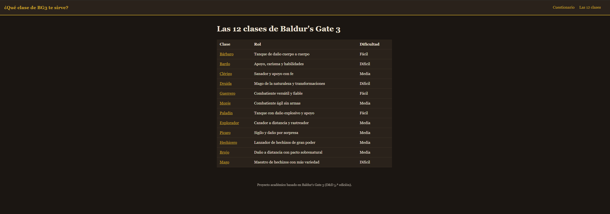
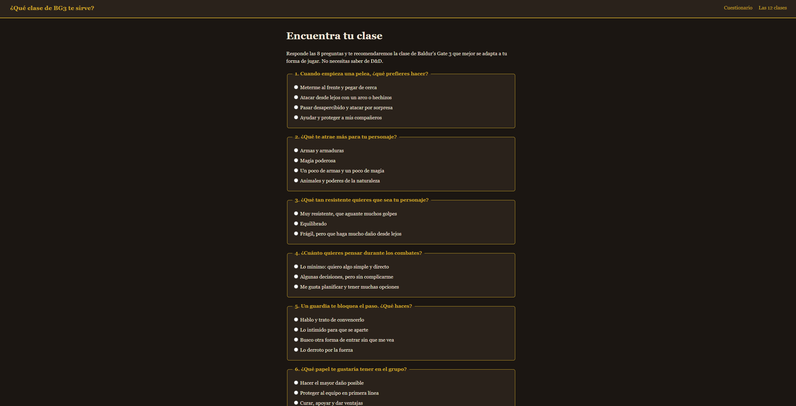
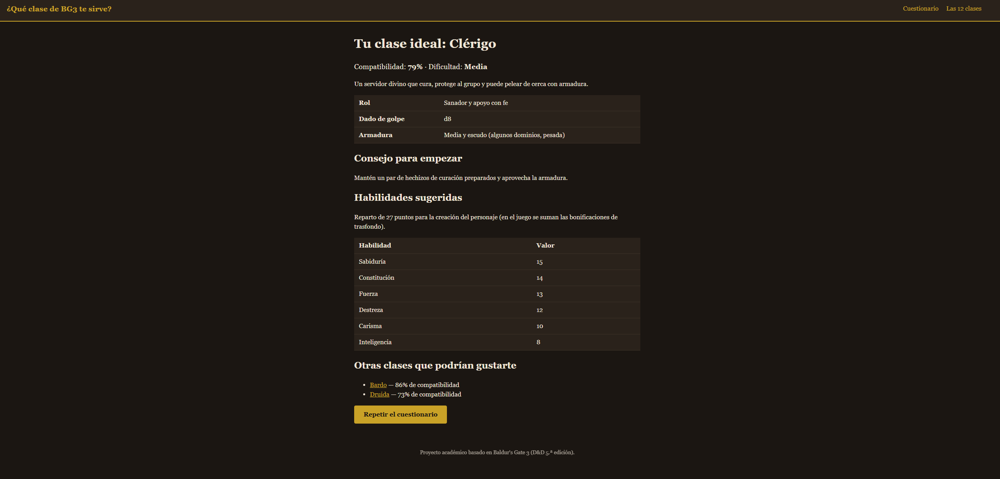
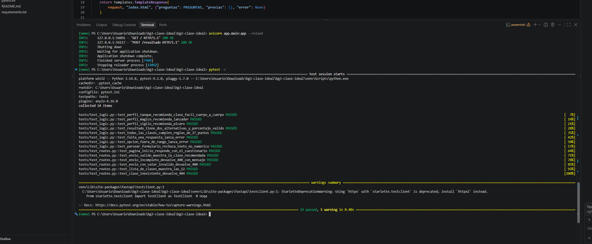

# ¿Qué clase de BG3 te sirve?

Autor: Paulo Badillo (paulobadillo@gmail.com) · GitHub: https://github.com/PauloBadi

## 1. Presentación del proyecto

**Nombre:** ¿Qué clase de BG3 te sirve?

**Propósito:** Aplicación web que hace al usuario 8 preguntas sencillas sobre su forma de jugar y le recomienda cuál de las 12 clases de *Baldur's Gate 3* (basado en D&D 5.ª edición) le conviene: Bárbaro, Bardo, Clérigo, Druida, Guerrero, Monje, Paladín, Explorador, Pícaro, Hechicero, Brujo o Mago.

**Problema que resuelve:** Quien no está acostumbrado a los RPG ni a D&D se enfrenta a 12 clases con reglas desconocidas y suele elegir mal. La aplicación traduce preferencias simples ("prefiero pegar de cerca", "quiero algo fácil") en una clase concreta y fácil de entender.

**Funcionalidad principal:** Recibe las respuestas del cuestionario, calcula un puntaje de afinidad para cada clase y muestra la clase recomendada con su porcentaje de compatibilidad, dificultad, rol, armadura, un consejo inicial, un reparto de habilidades que respeta la regla de 27 puntos del juego y dos clases alternativas.

## 2. Tecnologías utilizadas

| Tecnología | Función | Por qué se eligió |
|---|---|---|
| Python 3.10+ | Lenguaje de toda la lógica | Requerido por el curso; claro para modelar reglas y puntajes |
| FastAPI | Backend: define las rutas, recibe el formulario y devuelve HTML | Requerido; rutas simples y manejo de códigos HTTP |
| Jinja2 | Plantillas HTML dinámicas (formulario, resultado, catálogo) | Requerido; evita repetir HTML con herencia de plantillas |
| python-multipart | Permite que FastAPI lea formularios HTML (`POST`) | Necesario para `request.form()` |
| Uvicorn | Servidor que ejecuta la aplicación | Servidor estándar de FastAPI |
| pytest + httpx | Pruebas automatizadas; httpx lo usa `TestClient` | Requerido; permite probar rutas sin levantar el servidor |

No se usa base de datos: las clases y preguntas son datos fijos en `app/data.py`.

## 3. Arquitectura y organización

```
bg3-clase-ideal/
├── app/
│   ├── main.py        # Crea la app FastAPI y monta /static
│   ├── routes.py      # Rutas de FastAPI
│   ├── logic.py       # Lógica: validación, puntajes, ranking, habilidades
│   ├── data.py        # Datos: 12 clases y 8 preguntas
│   ├── templates/     # Plantillas Jinja2
│   │   ├── base.html, index.html, resultado.html
│   │   └── clases.html, clase.html, error.html
│   └── static/style.css
├── tests/
│   ├── test_logic.py  # Pruebas de la lógica
│   └── test_routes.py # Pruebas de las rutas con TestClient
├── docs/evidencias/   # Capturas de pantalla
├── requirements.txt
├── pytest.ini
└── README.md
```

- **Rutas de FastAPI:** `app/routes.py` (`/`, `/resultado`, `/clases`, `/clases/{slug}`).
- **Lógica de la aplicación:** `app/logic.py`. No depende de FastAPI ni de Jinja2, por lo que se prueba de forma independiente.
- **Datos:** `app/data.py` contiene las clases (con sus "rasgos") y las preguntas.
- **Plantillas Jinja2:** `base.html` define la estructura común; las demás la extienden con `` y ``. Se usan bucles (``) para generar preguntas, opciones y tablas, y condiciones (``) para mostrar errores y conservar respuestas.

### Cómo se calcula la recomendación

Cada clase tiene rasgos de 0 a 3 (cuerpo a cuerpo, distancia, magia, resistencia, sigilo, apoyo, social, naturaleza, simplicidad). Cada opción de respuesta suma o resta puntos a esos rasgos. El puntaje de una clase es la suma de (puntos de la opción × rasgo de la clase) en las 8 preguntas. El porcentaje de compatibilidad es ese puntaje dividido entre el máximo posible de la clase. En caso de empate gana la clase más fácil y luego el orden alfabético.

## 4. Funcionamiento de la aplicación

```
Navegador --GET /--> routes.inicio --> index.html (formulario)
Navegador --POST /resultado (p1..p8)--> routes.resultado
      --> logic.parsear_formulario --> logic.recomendar
      --> resultado.html            (si todo es válido, 200)
      --> index.html con error      (si hay error, 400)
```

- **Datos que recibe:** los campos `p1` a `p8` del formulario; cada uno es el índice de la opción elegida.
- **Cómo se procesan:** `logic.py` los convierte a enteros, valida que estén todos y dentro de rango, calcula el puntaje de las 12 clases, las ordena y asigna el reparto de habilidades según la prioridad de la clase ganadora (15, 14, 13, 12, 10, 8, que cuesta exactamente 27 puntos).
- **Función de FastAPI:** recibe la petición, entrega el formulario a la lógica, decide el código de estado (200, 400, 404) y devuelve la plantilla.
- **Cómo Jinja2 presenta los resultados:** `resultado.html` recibe el objeto de resultado y lo muestra con variables, tablas y bucles.
- **Información incorrecta:** si falta una pregunta, el valor no es numérico o la opción no existe, `logic.py` lanza `RespuestasInvalidas`; la ruta responde con estado **400**, vuelve a mostrar el formulario con el mensaje de error y conserva las respuestas ya marcadas. Una clase inexistente en `/clases/{slug}` devuelve **404**.

## 5. Instalación y ejecución

**Requisitos:** Python 3.10 o superior y `pip`.

```bash
git clone https://github.com/PauloBadi/bg3-clase-ideal.git
cd bg3-clase-ideal

python -m venv venv
# Windows:  venv\Scripts\activate
# Mac/Linux: source venv/bin/activate

pip install -r requirements.txt
uvicorn app.main:app --reload
```

Abrir en el navegador: http://127.0.0.1:8000

**Uso:** responder las 8 preguntas, pulsar "Ver mi clase" y revisar el resultado. En "Las 12 clases" (`/clases`) se puede consultar el catálogo completo.

## 6. Pruebas automatizadas

Ejecutar desde la raíz del proyecto:

```bash
pytest -v
```

Perfiles usados (índice de opción elegida en las preguntas 1 a 8):
tanque = `0,0,0,0,3,1,1,0` · mago = `1,1,2,2,0,0,3,3` · sigilo = `2,2,1,1,2,3,2,2`.

| Prueba | Qué comprueba | Datos | Resultado esperado | Resultado |
|---|---|---|---|---|
| `test_perfil_tanque_recomienda_clase_facil_cuerpo_a_cuerpo` | Funcionalidad principal | Perfil tanque | Bárbaro, Guerrero o Paladín, dificultad fácil | PASSED |
| `test_perfil_magico_recomienda_lanzador` | Funcionalidad principal | Perfil mago | Mago, Hechicero o Brujo | PASSED |
| `test_perfil_sigilo_recomienda_picaro` | Resultado esperado exacto | Perfil sigilo | Pícaro | PASSED |
| `test_resultado_tiene_dos_alternativas_y_porcentaje_valido` | Estructura del resultado | Perfil tanque | 2 alternativas, porcentaje entre 0 y 100 | PASSED |
| `test_todas_las_clases_cumplen_reglas_de_27_puntos` | Reglas del juego | Las 12 clases | Costo 27, valores entre 8 y 15 | PASSED |
| `test_falta_una_respuesta_lanza_error` | Entrada inválida | Falta la pregunta 3 | `RespuestasInvalidas` | PASSED |
| `test_opcion_fuera_de_rango_lanza_error` | Caso límite | Opción inexistente en la pregunta 1 | `RespuestasInvalidas` | PASSED |
| `test_parsear_formulario_rechaza_texto_no_numerico` | Entrada inválida | `p1="abc"` | `RespuestasInvalidas` | PASSED |
| `test_pagina_inicio_responde_con_el_cuestionario` | Ruta `GET /` | Sin datos | Estado 200 y formulario con `p8` | PASSED |
| `test_envio_valido_muestra_la_clase_recomendada` | Ruta `POST /resultado` | Perfil tanque | Estado 200 y una clase fácil | PASSED |
| `test_envio_incompleto_devuelve_400_con_mensaje` | Ruta con entrada inválida | Sin `p5` | Estado 400 y mensaje de error | PASSED |
| `test_envio_con_valor_invalido_devuelve_400` | Ruta con caso límite | `p2="99"` | Estado 400 | PASSED |
| `test_lista_de_clases_muestra_las_12` | Ruta `GET /clases` | Sin datos | Estado 200 y 12 enlaces | PASSED |
| `test_clase_inexistente_devuelve_404` | Ruta con recurso inexistente | `/clases/dragon` | Estado 404 | PASSED |

Las pruebas no dependen de servicios externos ni de aleatoriedad: el resultado es determinista.

## 7. Evidencias de funcionamiento

Capturas en `docs/evidencias/`:

- Interfaz principal: `docs/evidencias/01_interfaz.png`
- Aplicación en ejecución (cuestionario respondido): `docs/evidencias/02_cuestionario.png`
- Resultado del procesamiento: `docs/evidencias/03_resultado.png`
- Ejecución de pytest: `docs/evidencias/04_pytest.png`






## 8. Conclusiones

**Desafíos:** Traducir criterios subjetivos ("quiero algo simple") a un puntaje objetivo, y decidir qué hacer ante entradas incorrectas sin perder las respuestas del usuario.

**Soluciones:** Un sistema de rasgos por clase y por opción de respuesta, fácil de ajustar sin tocar el código; una excepción propia (`RespuestasInvalidas`) que la ruta convierte en un error 400 con el formulario conservado.

**Aprendizajes:**
- Separar la lógica (`logic.py`) de las rutas (`routes.py`) permitió probar el núcleo de la aplicación sin servidor web.
- Con Jinja2, la herencia de plantillas evita repetir HTML y los bucles generan el cuestionario a partir de los datos.
- `TestClient` de FastAPI comprueba rutas, códigos de estado y contenido HTML sin ejecutar Uvicorn, y las pruebas de casos inválidos aseguran que los errores se manejen correctamente.
